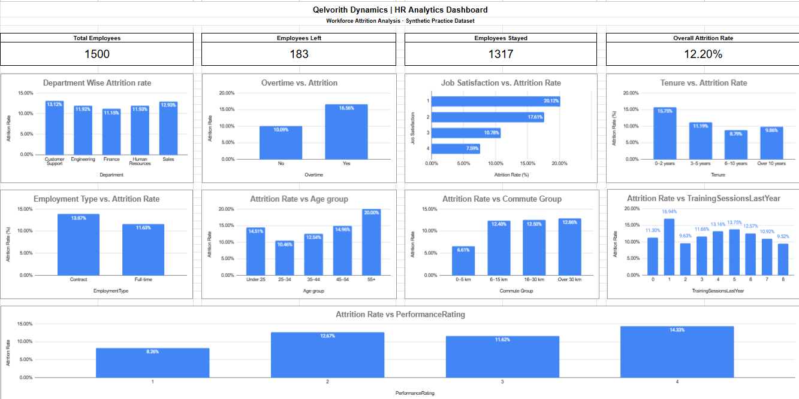

# Qelvorith Dynamics — HR Analytics

A portfolio case study using **MySQL** and **Google Sheets** to analyze employee attrition and communicate workforce trends.

> **Data notice:** This repository uses a synthetic practice dataset. Qelvorith Dynamics is a fictional company; results are illustrative and should not be interpreted as findings about a real organization.

## Project Overview

The project analyzes 1,500 employee records to understand how attrition varies across departments, overtime status, job satisfaction, tenure, employment type, age groups, commute distance, training participation, performance ratings, and salary.

### Business Questions

- What is the overall employee attrition rate?
- Which departments have the highest attrition rates?
- How does attrition differ by overtime status and job satisfaction?
- Which tenure groups have higher attrition?
- How does attrition vary by employment type, age group, and commute distance?
- How do training participation, performance rating, and salary relate to attrition?

## Tools

- **MySQL** — querying, aggregation, and data validation
- **Google Sheets** — KPI summary tables and dashboard charts
- **GitHub** — version control and project documentation

## Key Results

| Metric | Result |
|---|---:|
| Total employees | 1,500 |
| Employees who left | 183 |
| Employees who stayed | 1,317 |
| Overall attrition rate | 12.20% |
| Highest department attrition | Customer Support — 13.12% |
| Attrition with overtime | 16.56% |
| Attrition without overtime | 10.09% |
| Attrition for 0–2 years tenure | 15.75% |
| Contract employee attrition | 13.87% |
| Full-time employee attrition | 11.63% |

These are descriptive results from the synthetic dataset. Group differences show associations, not proof of cause and effect.

## Repository Structure

```text
Qelvorith-Dynamics-HR-Analytics/
├── data/
│   ├── raw/                  # Original synthetic dataset, if included
│   └── processed/            # Cleaned/derived data, if needed
├── sql/
│   ├── 01_data_quality/      # Validation queries
│   ├── 02_core_metrics/      # Overall KPI queries
│   └── 03_segment_analysis/  # Attrition by employee segment
├── google-sheets/
│   └── README.md             # Dashboard link and usage notes
├── docs/
│   ├── screenshots/          # Dashboard and query screenshots
│   ├── data_dictionary.md
│   └── methodology.md
├── reports/                  # Optional exports and findings
├── src/                      # Optional helper scripts
├── .gitignore
└── README.md
```

## How to Reproduce the SQL Analysis

1. Obtain the synthetic employee CSV from the project data source.
2. Create a MySQL database and import the CSV into a table named `employees`.
3. Confirm that column names and types match `docs/data_dictionary.md`.
4. Run SQL files in this order:
   - `sql/01_data_quality/`
   - `sql/02_core_metrics/`
   - `sql/03_segment_analysis/`
5. Open the Google Sheets dashboard or use the screenshots in `docs/screenshots/`.

Example table import depends on your MySQL setup and CSV location; see `docs/methodology.md` for notes.

## Dashboard

Add a shareable, view-only Google Sheets link here:

**Dashboard:** _Add your Google Sheets link_

Place screenshots in `docs/screenshots/` and embed the main dashboard image below when available:

```markdown

```

## Key Insights

- Customer Support has the highest department attrition rate in this dataset (13.12%).
- Employees recorded as working overtime have a 16.56% attrition rate versus 10.09% for those not working overtime.
- The 0–2 year tenure group has a 15.75% attrition rate.
- Job satisfaction level 1 has a 20.12% attrition rate; level 4 has 7.59%.
- Contract employees have a 13.87% attrition rate versus 11.63% for full-time employees.
- Commute groups over 5 km show higher attrition rates than the 0–5 km group in these records.

## Recommendations

- Investigate onboarding and manager support for employees in their first two years.
- Review overtime frequency, workload allocation, and staffing levels.
- Gather employee feedback about low satisfaction scores.
- Review Customer Support staffing and exit feedback.
- Investigate differences in contract employee experience.
- Treat commute support and flexible scheduling as hypotheses to evaluate, not proven solutions.

## Limitations

- The dataset is synthetic and intended for practice.
- This analysis is descriptive; it does not prove causation.
- The age 55+ group contains only 10 employees, so its attrition rate is unstable.
- The training-session pattern is not monotonic.
- ROI values, if used, are scenario assumptions and not measured savings.

## Future Improvements

- Add time-based employee snapshots for monthly or annual trend analysis.
- Add exit reasons and authorized employee feedback.
- Add filters/slicers to the dashboard.
- Test relationships among multiple variables and, if appropriate, conduct statistical tests.
- Replace illustrative ROI assumptions with validated costs and benefits.

## Author

Add your name, LinkedIn profile, and contact details here if you want them public.

## License

Choose a license before publishing. If you do not want others to reuse the work, omit a license file and review GitHub's default repository terms.
